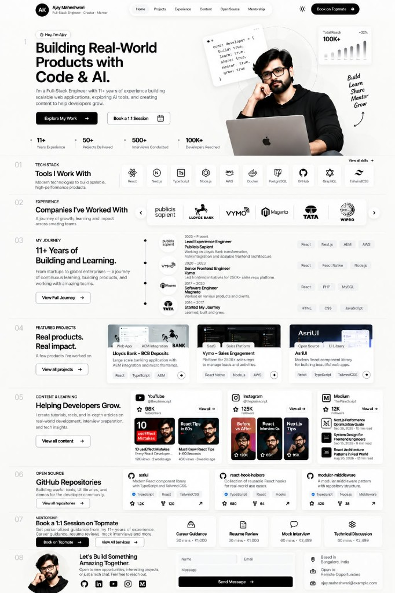

# Agent UI reference — portfolio mock

Use this document when creating or changing UI. **Match the reference image first**, then align tokens and components with the codebase.

## Run the Portfolio UI agent in Cursor

| Goal | How |
| --- | --- |
| Slash command | Agent chat → type **`/portfolio-ui`** |
| Pinned “custom mode” | `/portfolio-ui` → **Option+Enter** (Mac) or **Alt+Enter** (Win) |
| List in sidebar | **Customize → Skills** → `portfolio-ui` |
| Delegate subagent | Ask: “use the **portfolio-ui** subagent” (**Customize → Subagents**) |

Project files must live under this repo root (`portfolio/.cursor/…`). Reload the window if `/portfolio-ui` does not appear.

## Reference image (visual source of truth)

**File:** `design/reference/portfolio-ui-reference.jpg`  
**Open in the editor** (or attach in chat) before implementing layout, spacing, or new sections.

## Supporting specs (read in order)

| Order | Resource | Purpose |
| --- | --- | --- |
| 1 | `design/reference/portfolio-ui-reference.jpg` | Pixel-level layout, hierarchy, section order |
| 2 | `design.md` | Tokens, typography, grids, section ids |
| 3 | `src/shared/styles/portfolio.css` | Implemented design system (`--ref-*`) |
| 4 | `.cursor/rules/ponytail.mdc` | Architecture, AsriUI scope, quality bar |

## Section map (top → bottom)

Match the numbered rail on the left in the mock.

| Rail | Area | Key UI |
| --- | --- | --- |
| — | **Header** | Avatar + name + role; centered nav pill; theme toggle; black “Book on Topmate” CTA |
| — | **Hero** | Greeting pill; H1; bio; primary + secondary CTAs; stat row; portrait bento + code card + reach chart + handwritten labels |
| **01** | Tech stack | “Tools I Work With”; 2×5 icon grid on muted tiles |
| **02** | Companies | Logo carousel / strip with prev-next |
| **03** | Journey | Intro + “View Full Journey”; vertical timeline with logos, dates, tags on the right |
| **04** | Projects | Three large cards: image, category pills, title, tags, corner link |
| **05** | Content | YouTube / Instagram / Medium columns with thumbnails and metrics |
| **06** | Open source | Repo cards: name, description, stars/forks, language tags |
| **07** | Mentorship | Four service cards + Topmate CTAs |
| **08** | **Contact** | Footer: photo, socials, form, location / availability / email |

**DOM order in app:** `src/app/page.tsx` — Hero → About quote band → 01 Tech → 03 Journey → 02 Companies → 04 Projects → 05 Content (three bands) → 06 OSS → 07 Mentorship → Testimonials → 08 Contact footer.

## Visual rules (from mock)

- **Theme:** System default with optional toggle; light canvas per mock. Soft gray `SectionBand` alternation on journey+ blocks.
- **Chrome:** Thin borders (`--ref-border`), 12–16px radii, **no heavy shadows**.
- **Buttons:** Black filled pill (primary) with `→` where shown; white outline pill (secondary).
- **Section numbers:** Large, light gray (`--ref-number`), left rail on desktop.
- **Tags:** Small rounded pills on cards and timeline rows.
- **Fonts:** Inter for UI; **Caveat only** for hero handwritten annotations.

## Implementation checklist (agents)

Before marking UI work done:

1. [ ] Compared changed sections to `portfolio-ui-reference.jpg` (spacing, alignment, rail).
2. [ ] Used `RefSection` for blocks 01–08; hero/footer follow same max-width / rail patterns.
3. [ ] Styles live in `portfolio.css` (tokens first); `layout.tsx` imports that file.
4. [ ] Copy from `site.ts` / `features/*/data/*`, not hardcoded in components.
5. [ ] AsriUI limited to Form, Toast, Providers (see ponytail.mdc).
6. [ ] `npm run build` passes.

## Code entry points

| Mock region | Feature module |
| --- | --- |
| Header | `src/features/header/` |
| Hero | `src/features/hero/` |
| 01 | `src/features/tech-stack/` |
| 02 | `src/features/companies/` |
| 03 | `src/features/journey/` |
| 04 | `src/features/projects/` |
| 05 | `src/features/content/` |
| 06 | `src/features/open-source/` |
| 07 | `src/features/mentorship/` |
| 08 | `src/features/contact/` |
